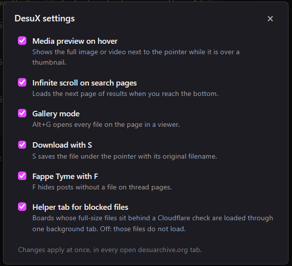

<div align="center">

# DesuX

**Enhancement script for [desuarchive.org](https://desuarchive.org)**

Infinite scrolling &middot; Media preview &middot; Gallery mode &middot; Downloads &middot; Fappe Tyme &middot; Settings

[](https://github.com/kpg-anon/DesuX/raw/main/desuX.user.js)

[]()
[](LICENSE)

</div>

---

## Requirements

A userscript manager such as [Violentmonkey](https://violentmonkey.github.io/), [Tampermonkey](https://www.tampermonkey.net/), or [Greasemonkey](https://www.greasespot.net/).

---

## Features

### Gallery Mode

Full-screen media gallery with pan, zoom, rotation, slideshow, video playback, and keyboard navigation. The thumbnail strip highlights the currently viewed media and the background thread syncs to the corresponding post.

Open with `Alt+G` or click any media thumbnail while the script is active.

https://github.com/user-attachments/assets/5bd98265-1671-42a5-873b-0c7d387a4d19

<details>
<summary><strong>Keyboard shortcuts</strong></summary>
<br>

| Key | Action |
|-----|--------|
| `Left` / `Right` | Previous / Next |
| `Space` | Toggle slideshow |
| `F` | Fullscreen |
| `H` | Flip horizontal |
| `R` | Rotate 90 degrees |
| `S` | Download (preserves transforms) |
| `T` | Toggle thumbnail strip |
| `M` | Mute / unmute video |
| `<` / `>` | Frame step (while paused) |
| `[` / `]` | Decrease / increase playback speed |
| `\` | Reset playback speed |
| `Scroll` | Zoom |
| `Esc` | Close |

</details>

---

### Infinite Scroll

Automatically loads the next page of results as you scroll on both thread and search pages.

https://github.com/user-attachments/assets/0bccb2fa-f157-4892-9744-bd607030d667

---

### Media Preview on Hover

Hover over any thumbnail to see a full-size preview. Supports images and video. The preview sits beside the pointer, on the side of the window with more room, and follows it as you move.

https://github.com/user-attachments/assets/59c0fa55-577e-46a6-8fde-05ff9853d4fa

---

### Fappe Tyme

Press `F` to toggle image-only mode. Hides text-only posts and shows only posts with media.

https://github.com/user-attachments/assets/05017a2e-2cbb-4074-a9ef-3c5daca97467

---

### Download

Press `S` while hovering over a thumbnail or viewing media in the gallery to download with the original filename. In gallery mode, flipped or rotated images are saved with transforms applied.

---

### Settings

Every feature can be switched off. Open the menu from the **DesuX** link in the site's top bar, or from your userscript manager's menu ("DesuX settings"). Changes apply at once, in every open desuarchive.org tab.



| Setting | Off means |
|---------|-----------|
| Media preview on hover | No preview when the pointer is over a thumbnail |
| Infinite scroll on search pages | Search results stay paged; the footer with the page links stays visible |
| Gallery mode | `Alt+G` does nothing |
| Download with S | `S` does nothing outside the gallery |
| Fappe Tyme with F | `F` does nothing on thread pages |
| Helper tab for blocked files | No helper tab is opened; files behind the Cloudflare check do not load (see below) |

---

## Blocked files and the helper tab

In November 2026 Desuarchive's file host, `desu-usergeneratedcontent.xyz`, began answering the full-size files of some boards (first seen on `/trash/`) with a Cloudflare browser check. Thumbnails and other boards such as `/mu/` are not checked.

What that changed:

- Opening a file in its own tab still works. The browser passes the check and Cloudflare gives it a `cf_clearance` cookie.
- That cookie is partitioned: the browser sends it only from tabs whose address bar is on the file host. A file embedded in a `desuarchive.org` page is requested without it, gets the check page (HTTP 403) instead of the file, and the browser reports `NS_ERROR_DOM_CORP_FAILED`. Hover previews and the gallery showed a broken image.
- `GM_xmlhttpRequest` is refused the same way, so `S` saved an HTML page instead of the file.

What DesuX does about it:

1. When a full-size file fails to load, DesuX opens one background tab at `https://desu-usergeneratedcontent.xyz/desux-helper`. The file host answers that address with its ordinary 404 page, which is not checked. The tab is titled "DesuX helper".
2. The helper tab is on the file host, so its requests carry the cookie. It fetches the file and hands the bytes to the desuarchive.org tab through the userscript manager's shared storage.
3. The file is shown from a `data:` URL, in an `<embed>` for images and a `<video>` for videos. Desuarchive's Content-Security-Policy refuses `blob:` URLs everywhere and `data:` URLs in ``.
4. If the browser has no clearance yet, the helper loads the file in a frame on its own page so the check can run there.

What you will notice:

- A purple spinner in place of the preview until the whole file has arrived. Files that load directly are shown as before.
- One extra background tab while you browse an affected board. You can close it; it is opened again when it is needed. After 10 minutes without a request it asks to be closed.
- Blocked videos are downloaded whole before they play.
- The script also runs on `https://desu-usergeneratedcontent.xyz/desux-helper` (nowhere else on the file host) and needs the `GM_openInTab`, `GM_getValue`, `GM_setValue`, `GM_deleteValue`, `GM_listValues` and `GM_addValueChangeListener` grants for this.

If a preview stays on the spinner and then shows an error, open the file in a tab once so the check can pass, then hover again. This was built and tested on Firefox with Violentmonkey.

---

## Changelog

See [CHANGELOG.md](CHANGELOG.md) for a full list of changes.

---

## Development

Source files live in `src/`. The installable userscript (`desuX.user.js`) is a generated artifact assembled by the build script.

```
src/
  metadata.txt              # userscript header
  main.js                   # bootstrap entrypoint
  assets/base64-icons.js    # embedded icon assets
  react-gallery/
    runtime.jsx             # React gallery component (bundled via esbuild)
  modules/
    styles.js               # injected CSS
    media-relay.js          # helper tab for files behind the Cloudflare check
    state.js                # shared runtime state
    settings.js             # settings storage and menu
    utils.js                # helper functions
    page.js                 # page-level helpers
    media-index.js          # media discovery and indexing
    hover-preview.js        # hover preview behavior
    search.js               # infinite scroll / search loading
    gallery.js              # gallery rendering and navigation
    download.js             # download and filename handling
    keyboard.js             # keyboard shortcut handling
    bootstrap.js            # startup wiring
build/
  build-userscript.mjs      # build script
```

The build bundles the React gallery with esbuild and Tailwind. This repo has no `node_modules`; the build script takes those packages from sibling project folders, or from the folders named in `DESUX_DEPS_DIR` (tailwindcss, @tailwindcss/node, react, react-dom, lucide-react) and `DESUX_ESBUILD_DIR` (esbuild).

Tailwind classes are collected by scanning string literals in `runtime.jsx`. A lone quote character in a comment there makes the scan skip classes, so keep quote characters out of comments in that file.

### Commands

```bash
npm run build   # rebuild desuX.user.js, desuX.meta.js and desuX.greasyfork.user.js
npm run watch   # rebuild on source changes
npm run check   # syntax-check the generated script
```

### Versioning

Bump the version in `src/metadata.txt`, rebuild, and commit source + generated output together.

### Greasy Fork

`desuX.greasyfork.user.js` is the same script with the header Greasy Fork needs: the namespace the listing has always used (`https://github.com/kpg-anon/scripts`), so existing installs keep updating, and no `@downloadURL` / `@updateURL`. The [Greasy Fork listing](https://greasyfork.org/en/scripts/483282-desu-x-enhancement-script-for-desuarchive-org) syncs from

```
https://github.com/kpg-anon/DesuX/raw/main/desuX.greasyfork.user.js
```

and its description ("additional info", Markdown) syncs from

```
https://github.com/kpg-anon/DesuX/raw/main/docs/greasyfork.md
```

so a push to `main` is all a release needs. Greasy Fork removes or rewrites `@downloadURL` and `@updateURL` in anything it hosts, so installs from there always update from Greasy Fork; the sync is what keeps both sources on the same version.

---

## License

[MIT](LICENSE)
