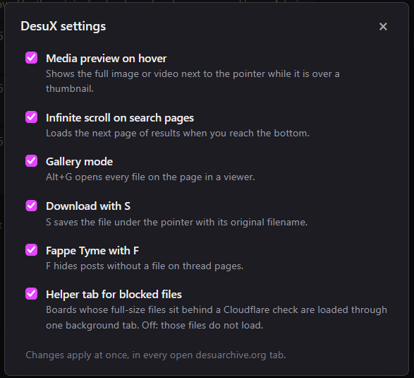

# DesuX

*Combines infinite scrolling, media preview on hover, download functionality, Fappe Tyme™ and gallery mode for desuarchive.org. Alt+G to activate gallery mode. 'F' to toggle fappe tyme. Press 'S' while hovering over a thumbnail or in gallery mode to download media with the original filename.*

Source and changelog: [github.com/kpg-anon/DesuX](https://github.com/kpg-anon/DesuX)

### Gallery Mode

<video src="https://raw.githubusercontent.com/kpg-anon/DesuX/main/docs/media/gallery.mp4" height="534" width="854" controls>
  Your browser does not support the video tag.
</video>

### Infinite Scroll

<video src="https://raw.githubusercontent.com/kpg-anon/DesuX/main/docs/media/infinite-scroll.mp4" height="516" width="960" controls>
  Your browser does not support the video tag.
</video>

### Media Preview on Hover

<video src="https://raw.githubusercontent.com/kpg-anon/DesuX/main/docs/media/hover-preview.mp4" height="516" width="960" controls>
  Your browser does not support the video tag.
</video>

### Fappe Tyme™

<video src="https://raw.githubusercontent.com/kpg-anon/DesuX/main/docs/media/fappe-tyme.mp4" height="442" width="854" controls>
  Your browser does not support the video tag.
</video>

### Settings

Every feature can be switched off. Open the menu from the **DesuX** link in the site's top bar, or from your userscript manager's menu ("DesuX settings"). Changes apply at once, in every open desuarchive.org tab.

### The "DesuX helper" tab

In November 2026 Desuarchive's file host, `desu-usergeneratedcontent.xyz`, began answering the full-size files of some boards (first seen on `/trash/`) with a Cloudflare browser check. A file opened in its own tab passes the check, but the same file embedded in a desuarchive.org page is refused, so previews and the gallery showed a broken image and `S` saved an HTML page.

DesuX works around this with one background tab on the file host, titled "DesuX helper". That tab can fetch the files, and it passes them to the desuarchive.org tab. What you will notice:

- A purple spinner in place of the preview until the whole file has arrived.
- One extra background tab while you browse an affected board. You can close it; it is opened again when it is needed.
- The first time in a while, Cloudflare wants its check passed by hand. A bar at the top of the page then offers **Open the check**, which opens the file in a tab. Pass the check there and close the tab; the waiting previews load without a page reload.
- The script asks for more permissions than before, and also runs on `https://desu-usergeneratedcontent.xyz/desux-helper`.

If you do not want the helper tab, switch off "Helper tab for blocked files" in the settings. Files behind the check then do not load.

Built and tested on Firefox with Violentmonkey.
